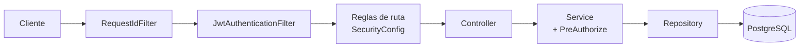
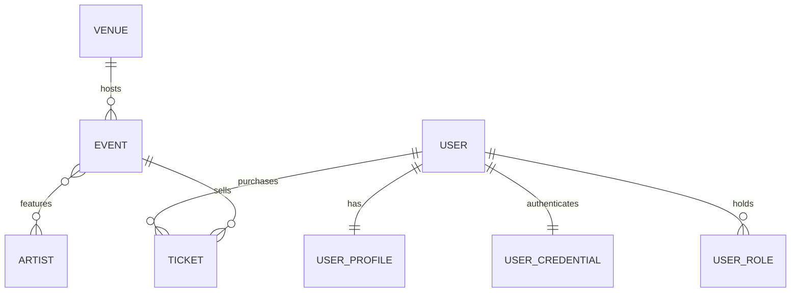

# PulsePass

API REST para descubrir eventos y administrar entradas de conciertos, festivales, conferencias y actividades culturales. Proyecto académico construido en cuatro fases sobre **Java 21 y Spring Boot 4.1.1**: persistencia, servicios, controladores REST y seguridad con **Spring Security + JWT**.

**Autores:** Camilo Antonio Bothia Fadul · Daniel Antonio Vergara Fernandez

---

## 1. Descripción

PulsePass modela venues, eventos, artistas, usuarios con perfil y tickets. Un usuario se registra, inicia sesión, compra entradas para eventos publicados y las consulta o cancela. El personal de operación valida las entradas en la puerta y los administradores publican eventos.

| Fase | Alcance | Documento de requisitos |
|---|---|---|
| 1. Persistencia | Entidades JPA, repositories, migraciones Flyway, pruebas con Testcontainers | `PRD_PulsePass.md` |
| 2. Servicios | Reglas de negocio, DTOs, mappers, transacciones, excepciones | `PRD_PulsePass.md` (reglas `BR-*`) |
| 3. Controladores | 20 operaciones REST, validación, contrato de error | `PRD_PulsePass_Capa_Controladores_v2` |
| 4. Seguridad | Registro con contraseña, login, JWT, roles, anti-IDOR | `PRD_PulsePass_Capa_Seguridad_Spring_Security_JJWT` |

## 2. Tecnologías

| Área | Herramienta |
|---|---|
| Lenguaje y framework | Java 21, Spring Boot 4.1.1 (starters modulares) |
| Persistencia | Spring Data JPA / Hibernate, PostgreSQL, `ddl-auto=validate` |
| Migraciones | Flyway (único responsable del esquema) |
| Mapeo | MapStruct (`componentModel = "spring"`) |
| Seguridad | Spring Security, JJWT 0.13.0, BCrypt |
| Pruebas | JUnit 5, Mockito, AssertJ, MockMvc, Testcontainers (PostgreSQL real, sin H2) |

## 3. Arquitectura



| Paquete (`com.pulse.pass`) | Responsabilidad |
|---|---|
| `domain` | Entidades y enums |
| `repository` | Query Methods y JPQL |
| `service` / `service.impl` | Reglas de negocio, transacciones, autorización por recurso |
| `controller` | Recibir la petición y delegar; no contiene lógica |
| `dto.request` / `dto.response` | Records de entrada y salida |
| `mapper` | Conversión entidad ↔ DTO |
| `exception` | Excepciones de negocio y `GlobalExceptionHandler` |
| `security` | Configuración, JWT, filtros, principal y handlers de 401/403 |

Cada capa tiene una sola responsabilidad: la seguridad de ruta vive en `SecurityConfig`, la propiedad de los recursos en `AuthorizationService`, y las reglas comerciales en los Services.

## 4. Modelo de datos



| Entidad | Atributos principales |
|---|---|
| `Venue` | id, code (único), name, city, address, capacity (> 0), active |
| `Event` | id, eventCode (único), name, description, category, status, eventDate, minimumAge, streamingUrl (opcional), venue |
| `Artist` | id, stageName (único), country, genre, active |
| `User` | id, username (único), email (único), active |
| `UserProfile` | id, firstName, lastName, phone, city, birthDate, user (FK única) |
| `Ticket` | id, ticketCode (único), type, price (≥ 0), status, purchaseDate, user, event |
| `UserCredential` | userId (compartido con `User`), hash BCrypt, passwordChangedAt |
| `UserRole` | clave compuesta (userId, role) |

| Enum | Valores |
|---|---|
| `EventCategory` | MUSIC, SPORTS, TECHNOLOGY, EDUCATION, CULTURE, ENTERTAINMENT |
| `EventStatus` | DRAFT, PUBLISHED, SOLD_OUT, CANCELLED, FINISHED |
| `TicketType` | GENERAL, VIP, BACKSTAGE, STUDENT |
| `TicketStatus` | RESERVED, PAID, CANCELLED, USED |
| `Role` | USER, STAFF, ADMIN |

**Relaciones**

- `Venue` 1 — N `Event`: todo evento pertenece a exactamente un venue.
- `Event` N — M `Artist`: tabla intermedia `event_artists` con clave primaria compuesta, que impide repetir el par.
- `User` 1 — 1 `UserProfile`: la FK del perfil es `UNIQUE`.
- `User` 1 — N `Ticket` y `Event` 1 — N `Ticket`: `Ticket` es una entidad propia y no un `@ManyToMany` porque guarda datos propios (código, tipo, precio, estado, fecha).
- `User` 1 — 1 `UserCredential` (`@MapsId`): la contraseña vive aparte del usuario, nunca en `User`.
- `User` 1 — N `UserRole`: un usuario puede tener varios roles.

Decisiones de modelado: enums persistidos por nombre (no por ordinal), precios en `BigDecimal` / `NUMERIC`, sin cascadas y sin Lombok en las entidades.

## 5. Migraciones Flyway

| Versión | Contenido |
|---|---|
| `V1__create_schema` | Tablas, claves, `UNIQUE` y `CHECK` (capacidad > 0, precio ≥ 0) |
| `V2__insert_initial_artists` | Artistas iniciales (incluye *Solar Beat*) |
| `V3__add_streaming_url_to_event` | Columna opcional `streaming_url` (hasta 500 caracteres) |
| `V4__security_credentials_roles` | `user_credentials` y `user_roles` con `CHECK` de rol |

Una base vacía se reconstruye ejecutando las migraciones en orden. `SecurityMigrationIT` valida además que `V4` se aplica correctamente sobre un esquema ya migrado con datos previos.

## 6. Consultas

Las consultas simples usan **Query Methods** y las que requieren `JOIN`, `DISTINCT` o `COUNT` usan **JPQL**. No hay SQL nativo.

| Repositorio | Método | Tipo | Requisito |
|---|---|---|---|
| `VenueRepository` | `findByCode` | Query Method | FR-VEN-001 |
| `EventRepository` | `findByEventCode` | Query Method | AC-002 |
| `EventRepository` | `findByStatusOrderByEventDateAsc` | Query Method | FR-EVT-005 |
| `EventRepository` | `findByVenue_Code` | Query Method | FR-VEN-004 |
| `EventRepository` | `findByArtistStageName` | JPQL (`DISTINCT`) | FR-SRC-001 |
| `EventRepository` | `findByCityAndArtistStageName` | JPQL | FR-SRC-002 |
| `EventRepository` | `findRecommendedEvents` | JPQL (`LOWER`/`LIKE`, `DISTINCT`, ordenada) | FR-SRC-003 |
| `ArtistRepository` | `findByStageName`, `findByActiveTrueOrderByStageNameAsc` | Query Method | FR-ART-001/002 |
| `UserRepository` | `findByUsername`, `findByEmailIgnoreCase`, `existsByUsername`, `existsByEmailIgnoreCase` | Query Method | FR-USR-001/002 |
| `UserProfileRepository` | `findByUser_Id` | Query Method | FR-USR-003 |
| `TicketRepository` | `findByTicketCode` | Query Method | FR-TKT-002 |
| `TicketRepository` | `findByUser_Email`, `findByUser_EmailAndStatus`, `findByUserEmailIgnoreCaseOrderByPurchaseDateDesc` | Query Method | FR-TKT-006 |
| `TicketRepository` | `findByEvent_EventCodeAndStatus` | Query Method | FR-TKT-007 |
| `TicketRepository` | `findByEvent_EventDateAfterOrderByEvent_EventDateAsc` | Query Method | FR-SRC-004 |
| `TicketRepository` | `countPaidByEventCode` | JPQL (`COUNT`) | FR-TKT-008 |
| `TicketRepository` | `findOwnerIdByTicketCode` | JPQL (proyección de id) | Anti-IDOR |
| `UserCredentialRepository` | `findByUserIdentifier`, `findWithUserByUserId` | JPQL (`JOIN FETCH`) | FR-SEC-AUTH |
| `UserRoleRepository` | `findByUser_Id` | Query Method | FR-SEC-AUTH-009 |

## 7. Reglas de negocio (capa de servicio)

**Usuarios**
- `username` y `email` únicos (el correo sin distinguir mayúsculas).
- La fecha de nacimiento no puede ser futura.
- El registro crea usuario, perfil, credencial BCrypt y rol `USER` en **una sola transacción**: si algo falla, no queda nada guardado.

**Eventos**
- El código es único; el venue debe existir y estar activo; la fecha debe ser futura.
- `minimumAge` no puede ser negativo (`0` significa sin restricción).
- Un evento nuevo nace en `DRAFT`.
- Solo un evento `DRAFT` puede publicarse, y solo si su fecha es futura y su venue está activo.
- Un artista no se asocia dos veces al mismo evento, ni a eventos `CANCELLED` o `FINISHED`.

**Tickets**
- El usuario debe existir y estar activo; el evento debe existir, estar `PUBLISHED` y ser futuro.
- El usuario debe cumplir la edad mínima **en la fecha del evento**.
- Debe haber cupo según la capacidad del venue.
- El precio depende del tipo: GENERAL 120 000, STUDENT 60 000, VIP 240 000, BACKSTAGE 360 000.
- El ticket nace `PAID`. Si es el último cupo, el evento pasa a `SOLD_OUT`.
- No se cancelan tickets `USED` ni `CANCELLED`, ni después de la fecha del evento.
- No se puede usar un ticket `CANCELLED` ni uno ya `USED`.

## 8. API REST

Las 20 operaciones heredadas de la fase 3 conservan URL, verbo y respuesta exitosa. La fase 4 añade dos rutas de autenticación.

| Método y ruta | Acceso | Éxito |
|---|---|---|
| `GET /api/venues/{code}` · `GET /api/venues/active` | Público | 200 |
| `GET /api/artists/{id}` · `/by-stage-name?stageName=` · `/active` | Público | 200 |
| `POST /api/events` | ADMIN | 201 |
| `GET /api/events/{eventCode}` | Público (un borrador responde 404 salvo a STAFF/ADMIN) | 200 |
| `GET /api/events/published` | Público | 200 |
| `GET /api/events/by-artist?stageName=` | Público (sin borradores salvo STAFF/ADMIN) | 200 |
| `PATCH /api/events/{eventCode}/publish` | ADMIN | 200 |
| `POST /api/events/{eventCode}/artists/{artistId}` | ADMIN | 200 |
| `POST /api/users` | Público (rol inicial siempre `USER`) | 201 |
| `GET /api/users/by-email?email=` · `/by-username?username=` | El propio usuario o ADMIN | 200 |
| `POST /api/tickets` | USER, y `userEmail` debe ser el suyo | 201 |
| `GET /api/tickets/{ticketCode}` | Dueño, STAFF o ADMIN | 200 |
| `GET /api/tickets/by-user?email=` | Dueño o ADMIN | 200 |
| `GET /api/events/{eventCode}/tickets/paid` | STAFF o ADMIN | 200 |
| `PATCH /api/tickets/{ticketCode}/cancel` | Dueño o ADMIN | 200 |
| `PATCH /api/tickets/{ticketCode}/use` | STAFF o ADMIN | 200 |
| `POST /api/auth/login` | Público | 200 |
| `GET /api/auth/me` | Autenticado | 200 |

**Autenticación**

- `POST /api/auth/login` recibe `{ "identifier", "password" }` (nombre de usuario o correo) y responde `{ "accessToken", "tokenType": "Bearer", "expiresIn": 900 }`.
- Las rutas protegidas exigen el encabezado `Authorization: Bearer <token>`. El token nunca se acepta por query string.
- `GET /api/auth/me` devuelve `id`, `username`, `email` y `roles`, nunca el hash.
- El registro no emite token: el flujo es registro → login.

**Contrato de error.** Todas las respuestas de error usan `ErrorResponse(timestamp, status, error, message, details)`:

| Código | Cuándo |
|---|---|
| 400 | Validación del cuerpo o parámetros faltantes (se evalúa **después** de autorizar) |
| 401 | Sin token, token inválido o vencido, usuario desactivado, login incorrecto |
| 403 | Autenticado sin el rol o sin ser dueño del recurso |
| 404 | Recurso inexistente, o evento en borrador para quien no es STAFF/ADMIN |
| 409 | Duplicados y reglas de negocio |
| 500 | Error inesperado, sin stack trace ni detalles internos |

Los mensajes de seguridad son uniformes: `Authentication is required`, `Invalid or expired token`, `Invalid credentials` y `Access denied`. Un login con contraseña incorrecta y uno con usuario inexistente son indistinguibles.

## 9. Seguridad

**Contraseñas.** BCrypt; entre 12 caracteres y 72 bytes (límite de BCrypt). Se guardan en `user_credentials`, nunca en `users`, y no aparecen en ninguna respuesta ni en los logs.

**JWT.** Firmado con HS256. Claims `sub` (id persistente del usuario), `iss`, `iat`, `exp` y `jti`. Se valida firma, emisor, expiración, algoritmo y sujeto. Vida útil de 15 minutos. Los roles **no viajan en el token**: se leen de la base de datos en cada petición, igual que el estado de la cuenta, de modo que retirar un rol o desactivar un usuario surte efecto en la siguiente petición.

**Sin sesión.** La API es stateless: sin `JSESSIONID`, sin CSRF, sin formulario ni Basic.

**Denegar por defecto.** Toda ruta no listada como pública exige autenticación (`anyRequest().authenticated()`).

**Roles**

| Rol | Puede |
|---|---|
| `USER` | Comprar, consultar y cancelar **sus** tickets; consultar **su** cuenta |
| `STAFF` | Consultar tickets, listar pagados por evento y marcar entradas como usadas; ver eventos en borrador |
| `ADMIN` | Crear y publicar eventos, asociar artistas, ver borradores, consultar cuentas y cancelar tickets ajenos |

`POST /api/tickets` es solo para `USER`: STAFF y ADMIN reciben 403 al comprar.

**Propiedad (anti-IDOR).** `AuthorizationService` (bean `authz`) decide el acceso a recursos con `@PreAuthorize` en los Services:

- La propiedad se compara por **id persistente**: el correo o username del request solo sirve para localizar al usuario; la decisión se toma con su id.
- Para un ticket, el dueño se obtiene de la base de datos con `findOwnerIdByTicketCode`; el `ticketCode` por sí solo nunca basta.
- Un correo inexistente y uno ajeno dan la misma respuesta (403), así que no se pueden enumerar cuentas.
- Un ticket inexistente se deja pasar a la capa de servicio, que responde 404.

**Decisiones de diseño**

| Decisión | Resolución |
|---|---|
| Ticket ajeno | Siempre **403** |
| Evento en borrador | **404** para el público (no revela que existe) |
| Registro | Atómico en `UserServiceImpl.register` |
| Alta de STAFF/ADMIN | Nunca por HTTP ni por migración; ver sección 12 |
| Secreto JWT | Solo por variable de entorno, con arranque fallido si falta o es débil |

**Trazabilidad.** Cada petición recibe un `X-Request-Id` (se reutiliza el entrante si es seguro, o se genera uno), que aparece en la respuesta y en cada línea de log. Se registran los logins correctos y fallidos y las denegaciones 401/403, sin credenciales, tokens ni cuerpos de petición.

## 10. Configuración

| Variable | Obligatoria | Descripción |
|---|---|---|
| `PULSEPASS_JWT_SECRET_BASE64` | Sí | Clave HMAC en Base64 con **al menos 32 bytes** decodificados. Si falta o es débil, la aplicación no arranca |
| `PULSEPASS_JWT_ISSUER` | No | Emisor del token; por defecto `pulsepass-api` |

`.env.example` es la plantilla sin secreto; el archivo `.env` real nunca se versiona. La conexión a PostgreSQL se define en `src/main/resources/application.yaml`. La duración del token (15 minutos por defecto) también es configurable. Para las pruebas, el secreto se define en `src/test/resources/application.properties` con un valor ficticio.

## 11. Cómo ejecutar

1. Tener **Java 21**, PostgreSQL accesible y las variables de la sección 10 definidas. Maven se ejecuta con el wrapper del repositorio (`mvnw`).
2. Al arrancar, Flyway crea o actualiza el esquema; Hibernate solo lo valida.
3. Para verificar el proyecto completo se usa el objetivo `clean verify`, que corre pruebas unitarias, de controlador e integración. Las pruebas de integración necesitan **Docker**, porque levantan PostgreSQL con Testcontainers; no requieren instalar PostgreSQL.

Surefire ejecuta las clases `*Test` y Failsafe las clases `*IT`.

## 12. Roles de prueba y alta controlada de STAFF/ADMIN

El registro público siempre crea cuentas `USER`: no existe ninguna ruta ni migración que otorgue STAFF o ADMIN. Para el entorno de desarrollo el procedimiento acordado es:

1. Registrar la cuenta con `POST /api/users`.
2. Promoverla directamente en la base de datos local, quitando el rol inicial y asignando el nuevo:

```sql
DELETE FROM user_roles
 WHERE user_id = (SELECT id FROM users WHERE username = 'laura.staff')
   AND role = 'USER';

INSERT INTO user_roles (user_id, role)
SELECT id, 'STAFF' FROM users WHERE username = 'laura.staff';
```

3. Iniciar sesión de nuevo para obtener un token (los roles se leen de la base en cada petición).

Se quita el rol `USER` porque `POST /api/tickets` es exclusivo de ese rol. Los tests de integración crean estas cuentas por su cuenta, sin tocar el flujo público.

**Cuentas de la demostración (PRD §23):** Andrea y Carlos (USER), Laura y Miguel (STAFF) y un administrador, creados por `AuthFlowIT`.

## 13. Pruebas

La estrategia sigue el PRD: unitarias con Mockito, controladores con MockMvc **con filtros de seguridad activos** (no se usa `addFilters = false`), e integración contra PostgreSQL real con Testcontainers. Los tests de controlador establecen la identidad con `@WithMockUser`.

| Fase | Pruebas |
|---|---|
| Persistencia | Integración con Testcontainers: restricciones `UNIQUE` y `CHECK`, relaciones, Query Methods y JPQL |
| Servicios | `EventServiceImplTest`, `TicketServiceImplTest`, `UserServiceImplTest` y demás, una por regla `BR-*` |
| Controladores | `VenueControllerTest`, `ArtistControllerTest`, `EventControllerTest`, `UserControllerTest`, `TicketControllerTest` |
| Seguridad (unitarias) | `JwtPropertiesTest`, `JwtServiceTest`, `CustomUserDetailsServiceTest`, `SecurityPrincipalTest`, `JwtAuthenticationFilterTest`, `RestSecurityHandlersTest`, `GlobalExceptionHandlerSecurityTest`, `AuthServiceImplTest`, `AuthorizationServiceImplTest`, `RequestIdFilterTest` |
| Seguridad (MockMvc) | `AuthControllerTest`, `SecurityMatrixTest` (las rutas contra cuatro identidades: anónimo, USER, STAFF, ADMIN) |
| Seguridad (integración) | `SecurityPersistenceIT`, `SecurityMigrationIT`, `UserRegistrationIT`, `AuthLoginIT`, `BearerAuthenticationIT`, `OwnershipSecurityIT`, `AuthFlowIT` |

`AuthFlowIT` ejecuta el escenario de demostración del PRD §23 de principio a fin: registro, login con `expiresIn = 900`, borrador oculto al público, intento de publicar por un `USER` (403), publicación por el administrador, compra propia, acceso a un ticket ajeno denegado, uso del ticket por STAFF y segundo uso rechazado (409), token alterado (401) y usuario desactivado con token aún vigente (401). También verifica que las cabeceras Bearer malformadas dan 401 y nunca 500.

## 14. Trazabilidad con el PRD de seguridad

| Requisito | Dónde se cumple |
|---|---|
| FR-SEC-AUTH-001 registro atómico | `UserServiceImpl.register`, `UserRegistrationIT` |
| FR-SEC-AUTH-002/003 login | `AuthServiceImpl`, `AuthLoginIT`, `AuthControllerTest` |
| FR-SEC-AUTH-004/009 estado y contexto | `CustomUserDetailsService`, `JwtAuthenticationFilter`, `BearerAuthenticationIT` |
| FR-SEC-AUTH-005/006/007 emisión, validación y Bearer | `JwtService`, `JwtServiceTest`, `JwtAuthenticationFilterTest` |
| FR-SEC-AUTH-008 sin sesión | `SecurityConfig`, `AuthFlowIT` (sin `Set-Cookie`) |
| FR-SEC-AUTH-010 `/api/auth/me` | `AuthController`, `BearerAuthenticationIT` |
| FR-SEC-VEN / ART / EVT / USR / TKT | `SecurityConfig`, `AuthorizationService`, `SecurityMatrixTest`, `OwnershipSecurityIT` |
| NFR-SEC-001 secretos | `JwtProperties` (enmascara el secreto), `.env.example` |
| NFR-SEC-002 Bearer malformado | `AuthFlowIT` |
| NFR-SEC-004 atomicidad | `UserRegistrationIT` |
| NFR-SEC-005/010 regresión y cobertura | Tests de controlador con identidad, `SecurityMatrixTest` |
| NFR-SEC-006 trazabilidad | `RequestIdFilter`, logs de `AuthServiceImpl` y `GlobalExceptionHandler` |
| NFR-SEC-009 sin registro de STAFF/ADMIN | Rol inicial fijo en `register`; sección 12 |

## 15. Limitaciones del MVP

Brechas conocidas y aceptadas, declaradas como pide el PRD:

- **STAFF es global**: el dominio no modela la asignación de personal a eventos, así que cualquier STAFF puede consultar tickets y marcar uso en cualquier evento. Debe restringirse en producción.
- **Sin revocación de tokens**: no hay denylist. Cerrar sesión borra el token del cliente, pero el token emitido sigue siendo válido hasta vencer (15 minutos). Mitigan la vida corta y la revisión del estado y los roles en cada petición.
- **Sin límite de intentos de login** ni protección contra fuerza bruta.
- **Sin rotación automática** del secreto HMAC ni gestor de secretos.
- **CORS no está configurado**: no hay frontend, y el navegador bloquea por defecto los orígenes cruzados. Habría que parametrizarlo al incorporar uno.
- **HTTPS** es obligatorio fuera de localhost y de ambientes de laboratorio aislados; la API no lo fuerza por sí misma.
- **Usuarios anteriores a la fase 4** no tienen credencial y no pueden iniciar sesión hasta que se les active una de forma segura; nunca se asignan contraseñas por defecto.
- **Rendimiento**: cada petición autenticada hace un número fijo de consultas (usuario con credencial y roles), sin crecer con el volumen de datos. No se midió carga.
- Fuera de alcance: pagos reales, notificaciones, reembolsos y frontend.
